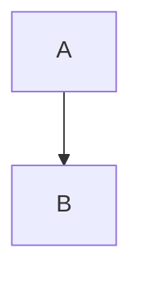

# Invalid charts

A block that is not JSON:

```vega-lite
{ "mark": "bar", "data": { "values": [ }
```

A block that is JSON but not a Vega-Lite spec:

```vega-lite
{ "data": { "values": [{ "a": 1 }] } }
```

A chart that renders:

```vega-lite
{
  "$schema": "https://vega.github.io/schema/vega-lite/v5.json",
  "data": { "values": [{ "a": "A", "b": 3 }, { "a": "B", "b": 5 }] },
  "mark": "bar",
  "encoding": {
    "x": { "field": "a", "type": "nominal" },
    "y": { "field": "b", "type": "quantitative" }
  }
}
```



```js
const after = 'the rest of the page';
```
